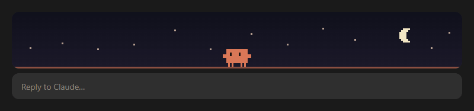
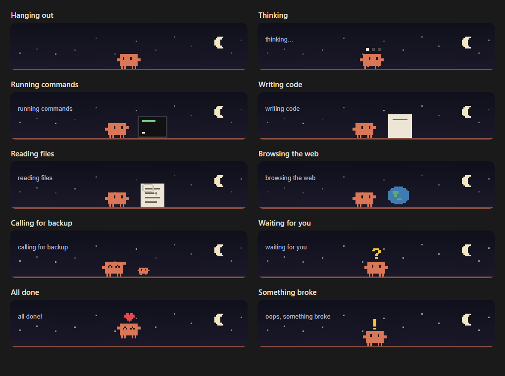
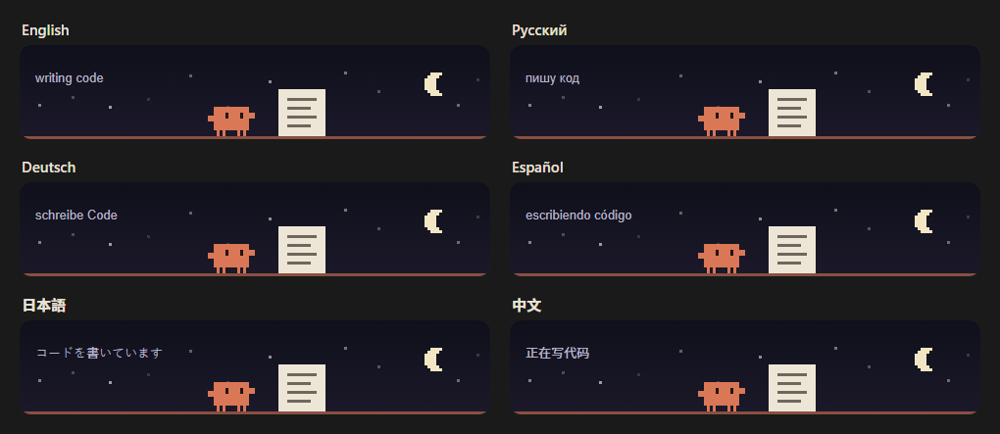

<div align="center">

# clawd-buddy

**A pixel pet for the Claude desktop app.**
Clawd lives right above your prompt box, wanders a starry night scene, and reacts to everything Claude does.

[](https://github.com/RovelLabs/clawd-buddy/tags)
[](LICENSE)
[](#install)
[](#speaks-your-language)
[](https://github.com/RovelLabs/clawd-buddy/stargazers)



</div>

## Why

Waiting for an AI agent is more fun with company. `clawd-buddy` is a small virtual pet and desktop mascot for Claude: a live, glanceable status indicator that shows what Claude is doing right now, without opening a panel or leaving your chat.

## What Clawd does



| When | Clawd |
| --- | --- |
| Nothing is happening | Walks around, looks about, hops, waves, dances, naps |
| Claude is thinking | Paces back and forth with thinking dots |
| Claude runs a command | Types next to a tiny terminal |
| Claude edits code | Fills a sheet of paper line by line |
| Claude reads or searches files | Scans a page with a magnifying glass |
| Claude browses the web | Stands by a spinning globe |
| Claude starts a subagent | A mini Clawd runs in to help |
| Claude needs your answer | Waves with a question mark |
| The turn finishes | Hops with a heart and dances |
| You interrupt, or something breaks | Looks sad, or shakes with an exclamation mark |

## Speaks your language

Clawd's captions follow the language of your Claude app, with no setup. Any other language falls back to English.



English, Русский, Українська, Deutsch, Español, Français, Italiano, Português, Polski, Türkçe, 日本語, 한국어, 中文, हिन्दी, Bahasa Indonesia.

## Install

**In the Claude desktop app:** click **+** next to the prompt box, then **Plugins**, **Add marketplace** with `RovelLabs/clawd-buddy`, then **Add plugin**.

**In a Claude Code terminal session:**

```
/plugin install clawd-buddy --marketplace RovelLabs/clawd-buddy
```

**From a shell:**

```
claude plugin install clawd-buddy --marketplace RovelLabs/clawd-buddy
```

Clawd then shows up above the prompt box in your new chats. Chats that are already open pick it up after you restart the app.

## Hide it

Use the `[-]` button next to the band to collapse it, or turn the plugin off in **Plugins**.

## Requirements

- The Claude desktop app. Clawd is drawn on the desktop surface only, so other surfaces show nothing.
- The plugin uses Claude Code's early-access hooks API, and it sits slightly outside the app's own card to cover its padding. An app update may shift the scene. Please [open an issue](https://github.com/RovelLabs/clawd-buddy/issues) if it does.

## Privacy

`clawd-buddy` sends nothing anywhere and stores nothing.

- It reads tool names to choose an animation, never their inputs or results.
- It reads the `locale` field of the Claude app's `config.json`, and falls back to the `LC_ALL` and `LANG` environment variables, to pick a language.
- It does not change, delay or block any tool call.

## Development

```
claude plugin validate .
claude plugin test .
```

| File | What it holds |
| --- | --- |
| `hooks/register.tsx` | The hooks: follows the turn and draws the band |
| `hooks/sprite.ts` | The sprite, the moods and the animated SVG scene |
| `hooks/captions.ts` | Captions and language detection |

To add a language, add its lines to `hooks/captions.ts` and open a pull request.

## Author

Made by [Rovel Labs](https://github.com/RovelLabs), built with [Claude Code](https://claude.com/claude-code).

## License

[MIT](LICENSE).

This is an unofficial fan project, not affiliated with or endorsed by Anthropic. Claude and Clawd belong to Anthropic.
